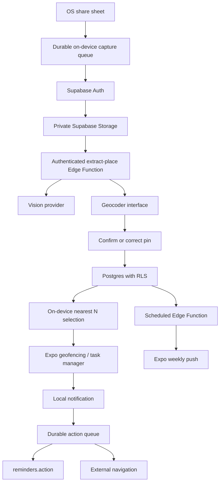

# Architecture

## Scope and ownership

Only saved places. Target: users aged 22-40 who save social food/place content. Success: at least 15% of first-save users Navigate or Been there from a reminder within seven days. Product modules own services and state; screens render state and dispatch intents. No custom server.

## Share to reminder

Persist a copied image or link locally before any network operation, including pre-auth shares; retain until server acknowledgement. Assign a stable capture UUID. Upload privately under user-id/item-id, create pending saved_item, invoke extract-place with the item ID. AI result is strictly validated and treated as untrusted content. Links without readable image content remain pending for screenshot/manual entry; never promise access to private social pages. Geocode on the server; the user confirms a candidate pin before enabling reminders. Retry failures with the same item ID; manual entry always remains available.

Register at most 20 nearest confirmed, unvisited places, with a default radius of 300m. Reconcile at app open, after place mutations, and on a supported significant-location task. Android/iOS wake restrictions require device validation; do not promise immediate global coverage after long-distance travel. Explain foreground and background location separately. Denied background permission leaves saved list and manual navigation usable.

A geofence task schedules a local notification with a stable reminder UUID and queues the sent row offline. Each action updates that same reminder ID and sent_at remains the original time. The first explicit action replaces ignored and remains stable on replay. Snooze suppresses further entries for 24 hours; a later reminder has a new ID. Queue action before opening Maps; replay actions after the sent-row insert. Phase 3 tests transitions and ownership. Server persistence is eventually consistent when offline.

## Four product tables

- users: auth-linked id, phone/email, created_at, reminder_radius_m. Private profile metadata can hold push token/preferences and digest selection IDs without a fifth product table.
- saved_items: id, user_id, image_url (private object reference, never a permanent public URL), source_app, raw_ai_json, status, created_at.
- places: id, saved_item_id, name, address, lat, lng, category, confidence. Use PostGIS geography and a GiST index; ownership inherited through saved_item.
- reminders: id, place_id, sent_at, action. Ownership inherited through places/saved_items. Add a server action timestamp in the migration to distinguish action time from notification time.

Index user_id and foreign keys. Every table and storage bucket has RLS. Auth trigger creates profile; ownership cannot be reassigned. Delete-account Edge Function authenticates the caller, removes private images and auth user with cascading product rows; retries handle partial failures. AI invocation has capped file type/size, ownership checks, per-user quotas, transactional idempotency, sanitized errors and no image logging.

## Metric

Denominator: users with a first saved_item.created_at whose seven-day window has completed. Numerator: distinct users whose reminder action is navigate or been_there and action timestamp lies from first save through seven days. Include pending first saves; do not filter denominator to successful extraction. Preserve server action timing and stable IDs; PostHog mirrors the funnel, SQL is authoritative. Clock/offline reporting limits must be documented in Phase 4.

## Privacy and digest trade-off

Continuous location never leaves the device. On-device foreground selection may upload only nearby saved-place IDs and selection time to profile metadata for weekly push, with a short expiry and explanation/consent. If stale or permission denied, skip the proximity digest. This reveals coarse proximity to saved places and must be disclosed. A server cannot truthfully compute current nearby places without some proximity signal. No precise coordinates are uploaded. Phase 4 must verify this approach with users before release.

## Tooling and dependencies

Expo SDK 57 official blank template versions pair React 19.2.3 with React Native 0.86.3. expo-dev-client enables custom native modules. TypeScript strict mode prevents implicit domain contracts. ESLint's Expo config and Prettier share repository conventions. Jest + jest-expo + Testing Library validate behavior without native devices. npm workspaces minimize tooling; lockfile and npm ci provide reproducibility. Install Supabase, location, notifications, PostHog, schema validation and share-intent modules in their owning phases after compatibility checks; foundation has no unused runtime clients.

## Phase 1 implementation status

Four-table SQL and private capture policies are implemented. Quota fields on users and lease fields on saved_items remain service-controlled through column grants and service-only transactional RPCs. The function verifies Auth user tokens before privileged work, caches validated JSON, and leaves confirmation/geocoding to Phase 2. [Phase 1 report](PHASE-1-REPORT.md) distinguishes passing embedded SQL/handler checks from the outstanding managed-service and real vision gates.
